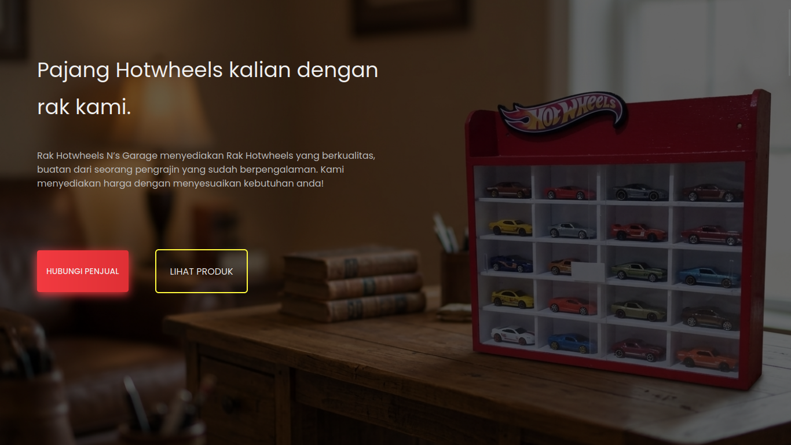
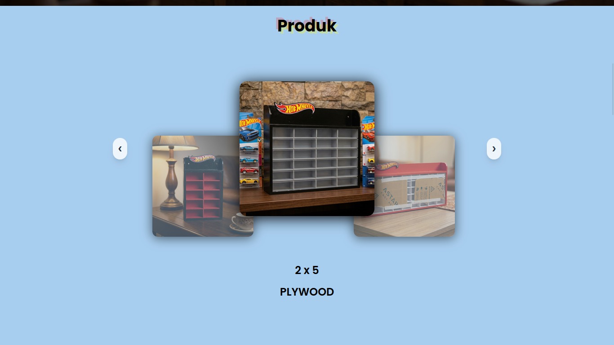

# Landing Page Rak Hotwheels – Nandra's Garage

Landing page untuk pengrajin rak Hotwheels agar calon pembeli bisa melihat produk, harga, dan langsung memesan lewat WhatsApp.

🔗 **Live demo:** https://landing-page-rak-hw.vercel.app/




## Latar Belakang

Pengrajin rak Hotwheels biasanya menjual lewat chat dan media sosial, sehingga calon pembeli sulit melihat produk, harga, dan cara pesan di satu tempat. Landing page ini dibuat untuk merangkum semuanya dalam satu halaman, sekaligus meningkatkan kepercayaan calon pembeli.

## Fitur

- Responsive di HP dan desktop
- Tombol "Hubungi Penjual" langsung ke WhatsApp di beberapa titik halaman
- Galeri produk berbentuk carousel dengan auto-rotate dan tombol navigasi
- Section penawaran lengkap dengan harga
- Langkah pemesanan yang jelas
- Kontak WhatsApp dan Instagram
- Smooth scroll antar section

## Teknologi

- HTML, CSS, JavaScript
- [Tailwind CSS](https://tailwindcss.com/) v4
- [Vite](https://vite.dev/) sebagai development server dan bundler
- Font [Poppins](https://fonts.google.com/specimen/Poppins) dari Google Fonts
- Deploy di [Vercel](https://vercel.com/)

## Struktur Folder

```
├── assets/            # Gambar: logo, hero, foto rak, ikon, screenshot
├── public/
├── src/
│   ├── style.css      # Tailwind, warna tema, dan style komponen
│   └── main.js        # Logika galeri produk (carousel)
├── .gitignore
├── index.html         # Halaman utama
├── package-lock.json
├── package.json
├── README.md
└── vite.config.js
```

## Cara Menjalankan

Pastikan [Node.js](https://nodejs.org/) sudah terpasang.

1. Clone repo ini
   ```bash
   git clone https://github.com/asvaragust/landing-page-rak-hw.git
   cd landing-page-rak-hw
   ```
2. Install dependency
   ```bash
   npm install
   ```
3. Jalankan development server
   ```bash
   npm run dev
   ```
4. Buka alamat yang muncul di terminal (biasanya `http://localhost:5173`)

### Build untuk produksi

```bash
npm run build
```

Hasilnya ada di folder `dist/`. Untuk melihat hasil build secara lokal:

```bash
npm run preview
```

## Cara Mengubah Konten

Semua teks ada di `index.html`. Cari section-nya lewat komentar penanda (`NAVBAR`, `HOME`, `PRODUK`, `PENAWARAN`, `LANGKAH PEMESANAN`, `KONTAK`, `FOOTER`).

| Yang ingin diubah | Lokasi |
| --- | --- |
| Judul dan deskripsi hero | Section `HOME` di `index.html` |
| Harga dan deskripsi paket | Section `PENAWARAN` di `index.html` |
| Langkah pemesanan | Section `LANGKAH PEMESANAN` di `index.html` |
| Nomor WhatsApp | Cari `6283894212194` di `index.html`, ganti semuanya (format `62` tanpa 0 di depan), lalu ganti juga teks nomor yang tampil |
| Username Instagram | Section `KONTAK` dan `FOOTER` di `index.html` |
| Warna tema | Variabel di `@theme` dan `:root` pada `src/style.css` |
| Foto produk | Ganti file `assets/rak1.jpeg` sampai `assets/rak4.jpeg`, atau ganti nama file di `index.html` |
| Logo dan background hero | `assets/logo.png` dan `assets/hero-bg.jpeg` |

### Menambah foto di galeri produk

Salin satu blok `<div class="produk-item ...">` di section `PRODUK`, lalu ganti `src` dan `alt`-nya. Item baru otomatis masuk ke carousel.

### Mengatur kecepatan auto-rotate galeri

Ubah nilai `autoRotateInterval` di `src/main.js` (satuan milidetik).

## Deploy

Project ini di-deploy lewat Vercel:

1. Push project ke GitHub
2. Import repo di [vercel.com](https://vercel.com/)
3. Framework terdeteksi sebagai Vite, lalu klik **Deploy**

Setiap kali ada push ke branch utama, Vercel otomatis memperbarui situsnya.

## Rencana Pengembangan

- [ ] Section testimoni dan foto hasil pemasangan
- [ ] Swipe di galeri untuk HP
- [ ] Pesan otomatis pada link WhatsApp
- [ ] Meta description dan Open Graph untuk preview link

## Author

**Asvaragust** – [GitHub](https://github.com/asvaragust)

## Hak Cipta

© 2026 Nandra's Garage. Foto produk dan logo adalah milik Nandra's Garage.